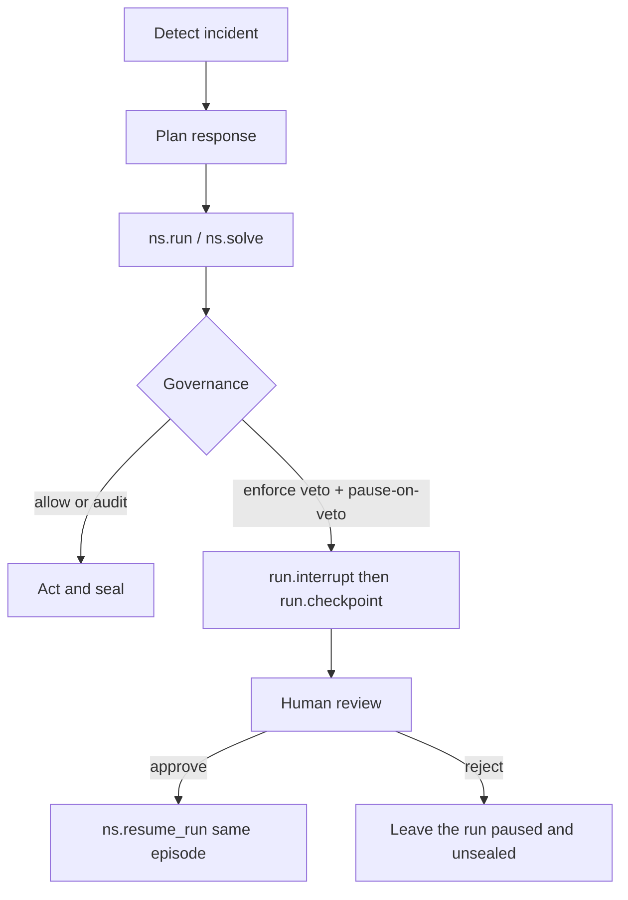

This tutorial wires a small incident-response loop onto the canonical Noēsis runtime: detect, plan, govern, then either seal or pause. Approval continues the **same** episode with `ns.resume_run(...)`. It does not start a follow-up `ns.run(...)`.

## What you'll build

- A mock detector and responder (swap for Prometheus, PagerDuty, LangGraph later)
- An intuition policy for org-specific incident rules
- Enforce-mode governance with pause-on-veto
- A review step that resumes from `run.checkpoint` on the same episode ID

## Prerequisites

- Completed [Your first policy](/tutorials/first-policy)
- Familiarity with the [cognitive loop](/explanation/cognitive-loop) and [human-in-the-loop](/guides/human-in-the-loop) continuation contract

## Architecture



| Component | Noēsis concept | Production swap |
| --- | --- | --- |
| Detector | Observe input | Prometheus / Alertmanager / PagerDuty |
| Planner | Your code before `ns.run` | LangGraph / runbook lookup |
| Intuition policy | `DirectedIntuition.advise` | Org change-control rules |
| Pre-act gate | `governance_mode="enforce"` | Built-in `PreActGovernor` |
| Review | `run.checkpoint` + `ns.resume_run` | Slack / ServiceNow on the same run ID |

<Warning>
`ns.run(...)` and `ns.solve(...)` seal the episode when they terminate. After `final.json` exists, `ns.interrupt` / `ns.checkpoint` / `ns.resume_run` raise `RunSealedError`. Do not start a second episode to represent approval.
</Warning>

## Step 1: Write the incident policy

Intuition can hint, intervene, or veto. **Pause-on-veto is a Governance runtime mode**, not an intuition patch. Returning `{"requires_approval": True}` does not pause the run.

`advise` receives a snapshot with `task` and `tags` (see `_build_snapshot` in `noesis/usecases/episode_runner.py`). It does not receive a free-form `proposed_action` key unless you put that value in `tags`.

Create `prod_guard.py` (same shape as `examples/incident_triage/prod_guard.py`):

```python prod_guard.py
import re
import noesis as ns
from noesis.intuition import IntuitionEvent

_DESTRUCT = re.compile(r"\b(drop\s+db|delete\s+all|shutdown\s+cluster|wipe)\b", re.I)


class IncidentPolicy(ns.DirectedIntuition):
    """Org rules that steer planning. Fail-closed gates still live in Governance."""

    __version__ = "1.0"

    def advise(self, state: dict) -> IntuitionEvent | None:
        task = str(state.get("task") or "").strip()
        tags = state.get("tags") or {}
        action = str(tags.get("proposed_action") or "").lower()

        if _DESTRUCT.search(task) or tags.get("risk") == "high":
            return self.veto(
                advice="Blocked: destructive or high-risk incident action.",
                target="plan",
                rationale="Dangerous ops require a privileged change window.",
            )

        if action in {"rollback", "restart", "scale_down", "delete"} and self._is_off_hours():
            return self.hint(
                advice="Caution: high-risk action outside the change window.",
                target="plan",
                rationale="Consider waiting for on-call handoff.",
            )

        return None

    def _is_off_hours(self) -> bool:
        from datetime import datetime

        hour = datetime.now().hour
        return hour < 9 or hour > 18
```

Direction records steering (`applied` / `blocked`). Governance is the layer that can stop actuation. See [Faculties](/explanation/faculties).

## Step 2: Detect and plan (mocks)

```python detector.py
from dataclasses import dataclass
from typing import Literal


@dataclass
class Incident:
    id: str
    title: str
    severity: Literal["low", "medium", "high", "critical"]
    service: str
    signals: dict


def detect_incidents() -> list[Incident]:
    return [
        Incident(
            id="INC-001",
            title="API latency spike in checkout service",
            severity="high",
            service="checkout-api",
            signals={"p99_latency_ms": 2500, "error_rate": 0.05, "affected_users": 1200},
        )
    ]
```

```python responder.py
from dataclasses import dataclass


@dataclass
class ResponsePlan:
    action: str
    target: str
    parameters: dict
    confidence: float
    rationale: str


def plan_response(incident) -> ResponsePlan:
    if incident.signals.get("error_rate", 0) > 0.1:
        return ResponsePlan(
            action="rollback",
            target=incident.service,
            parameters={"to_version": "v1.2.3"},
            confidence=0.85,
            rationale="Error rate exceeds threshold; roll back to last stable version.",
        )

    if incident.signals.get("p99_latency_ms", 0) > 2000:
        return ResponsePlan(
            action="scale_up",
            target=incident.service,
            parameters={"replicas": 10},
            confidence=0.75,
            rationale="Latency spike suggests capacity pressure.",
        )

    return ResponsePlan(
        action="monitor",
        target=incident.service,
        parameters={"duration_minutes": 15},
        confidence=0.9,
        rationale="Signals within range; keep watching.",
    )
```

## Step 3: Run with enforce + pause-on-veto

`planner_mode` chooses the planner. `governance_mode` is independent. Pause-on-veto is tested with `planner_mode="minimal"` and `governance_mode="enforce"` in `tests/runtime/test_run_lifecycle.py`.

The built-in `PreActGovernor` (`noesis/domain/faculties/governance.py`) vetoes when the goal or a plan step contains `danger`, or matches `veto|destroy|shutdown|wipe`. `write|delete|drop` is an **audit** (action still proceeds). `rollback` / `scale_up` / `monitor` are not veto keywords by themselves.

```python incident_triage.py
from pathlib import Path

import noesis as ns
from detector import detect_incidents
from responder import plan_response
from prod_guard import IncidentPolicy


def checkpoint_id_from_events(events: list[dict]) -> str | None:
    for event in reversed(events):
        if event.get("phase") == "runtime" and event.get("event_type") == "run.checkpoint":
            checkpoint_id = (event.get("payload") or {}).get("checkpoint_id")
            if isinstance(checkpoint_id, str) and checkpoint_id:
                return checkpoint_id
    return None


def run_triage() -> None:
    ns.set(
        planner_mode="minimal",
        governance_mode="enforce",
        governance_failure_policy="fail_closed",
        governance_pause_on_veto=True,
    )

    for incident in detect_incidents():
        plan = plan_response(incident)
        task = (
            f"Respond to {incident.id}: {plan.action} on {incident.service}. "
            f"{incident.title}"
        )

        episode_id = ns.run(
            task,
            intuition=IncidentPolicy(),
            process="incident-triage",
            tags={
                "incident_id": incident.id,
                "severity": incident.severity,
                "proposed_action": plan.action,
                "environment": "production",
            },
        )

        events = list(ns.events.read(episode_id))
        from noesis.io import paths

        run_dir = Path(paths(episode_id)["dir"])
        sealed = (run_dir / "final.json").exists()
        checkpoint_id = checkpoint_id_from_events(events)

        print(f"Incident {incident.id} episode={episode_id}")
        print(f"  proposed_action={plan.action} sealed={sealed}")

        if checkpoint_id and not sealed:
            print(f"  paused at checkpoint {checkpoint_id} (no act, no terminate)")
            print("  review events with: noesis events", episode_id, "--phase governance")
            continue

        if sealed:
            summary = ns.summary.read(episode_id)
            print(f"  sealed success={summary.get('metrics', {}).get('success')}")


if __name__ == "__main__":
    run_triage()
```

Group related pages with `process=` / `noesis --process`. Episode bundles stay flat: `.noesis/episodes/ep_<ULID>/`.

## Step 4: Review a paused run

Paused enforce vetoes emit `action_candidate → governance → run.interrupt → run.checkpoint`. There is no `act`, no `terminate`, and no `final.json` / `manifest.json` yet. `state.json` outcomes use `status="partial"`.

Inspect:

```bash
noesis view ep_01JH6Z2V9Q2K6Y6N0QZ7K2QW8C
noesis events ep_01JH6Z2V9Q2K6Y6N0QZ7K2QW8C --phase governance
noesis explain ep_01JH6Z2V9Q2K6Y6N0QZ7K2QW8C
```

Continue the **same** run after approval:

```python review.py
from pathlib import Path

import noesis as ns
from noesis.io import paths


def resume_if_paused(episode_id: str, *, approved: bool) -> str | None:
    run_dir = Path(paths(episode_id)["dir"])
    if (run_dir / "final.json").exists():
        print(f"{episode_id} is sealed; interrupt/resume will raise RunSealedError")
        return None

    events = list(ns.events.read(episode_id))
    checkpoint_id = None
    for event in reversed(events):
        if event.get("phase") == "runtime" and event.get("event_type") == "run.checkpoint":
            value = (event.get("payload") or {}).get("checkpoint_id")
            if isinstance(value, str) and value:
                checkpoint_id = value
                break
    if checkpoint_id is None:
        print(f"{episode_id} has no run.checkpoint event")
        return None

    if not approved:
        print(f"rejected; leave {episode_id} paused and unsealed")
        return None

    # Same episode ID. For ns.run / minimal checkpoints, omitting using= is allowed.
    return ns.resume_run(episode_id, checkpoint_id=checkpoint_id)
```

<Note>
`resume_run` continues the paused episode; it does not rewrite the original goal. If Governance still vetoes that goal (for example the task still contains `danger`), the run can pause or terminate again. Approval is not a bypass of `PreActGovernor`.
</Note>

For a side-effect that must itself be gated, use [`ns.governed_act(...)`](/tutorials/governed-side-effects) (`kind="shell"` or `kind="adapter"`) with the same `governance_pause_on_veto` setting. Pause still raises `NoesisVeto` and leaves that governed episode unsealed.

## Constraints and pitfalls

| Pitfall | What actually happens |
| --- | --- |
| Start `ns.run("... [APPROVED]")` after the first episode | New episode ID; original sealed/paused run is not continued |
| Call `ns.interrupt` after `ns.run` returns a sealed episode | `RunSealedError` |
| Treat intuition `intervene(..., patch={"requires_approval": True})` as a pause | Run continues unless Governance vetoes |
| Expect `planner_mode="minimal"` to disable Governance | Governance follows `governance_mode`; pause-on-veto works in minimal |
| Set `NOESIS_RUNS_DIR=/srv/noesis/episodes` and look for bundles there | Unless the parent directory is `.noesis`, artifacts land under `{runs_dir}/.noesis/episodes` |
| `noesis run TASK --intuition my_policy:Class` | Shipped `noesis run` has no `--intuition` / `--policy` flag; attach policies in Python |

## Artifacts

| File | Allow / audit / sealed veto | Paused enforce veto |
| --- | --- | --- |
| `events.jsonl` | Includes `terminate` | `run.interrupt` then `run.checkpoint`; no `act` |
| `state.json` | Terminal outcomes | `outcomes.status="partial"` |
| `final.json` + `manifest.json` | Present (sealed) | Absent until continuation or a later terminal path |
| `checkpoints/<id>/checkpoint.json` | Not the veto-pause path | Present when pause-on-veto fires |

## Production notes

- Replace the detector/planner mocks with your monitoring and runbook stack.
- Keep approval on the paused episode ID (`resume_run`), not a linked follow-up episode.
- Do not hand-edit `events.jsonl` or checkpoint files before resume; checkpoint consistency checks are fail-closed.
- `examples/incident_triage/` ships Gradio/Streamlit viewers around `incident_graph`. Those UIs inspect artifacts after a run; they simulate in-graph approval and still call the legacy `ns.run_using` helper. Use this tutorial's pause-on-veto path when you need same-run continuation.
- Export veto and pause counts with the [metrics guide](/guides/export-metrics).

## Next steps

<CardGroup cols={2}>
  <Card title="Human-in-the-loop" icon="user-check" href="/guides/human-in-the-loop">
    Pause, checkpoint, and resume contracts.
  </Card>
  <Card title="Governed side effects" icon="shield" href="/tutorials/governed-side-effects">
    Gate shell/adapter actions at the OS boundary.
  </Card>
</CardGroup>
